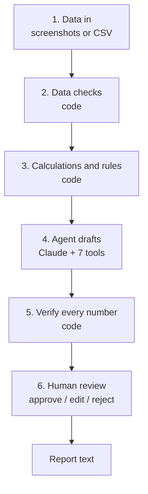

# Search Report Agent

An LLM agent that turns Google Search dashboard data into a client-ready performance analysis: overall scale and efficiency, category roles, search funnel diagnosis and three recommendations.

It is built around one principle: **the AI explains, code calculates, a person decides.**

- Code does every calculation, checks the data before any AI runs, and assigns category roles from written rules.
- The agent chooses which calculations to look at (through seven tools) and writes the commentary, citing the source of every number.
- A verifier checks every number in the draft against the calculations, and nothing reaches the report until a person approves it.

> Prototype. All data in this repository is synthetic or anonymised.

## Why

Search reporting follows a market → keyword-category hierarchy. Asking a general chatbot to read dashboard screenshots and "analyse" them produces fluent text with three recurring problems: arithmetic errors, no questioning of the input (for example, categories that don't add up to the market total), and long review time because every number has to be traced by hand. This agent removes those problems by design rather than by prompting harder. See [docs/DESIGN.md](docs/DESIGN.md).

## How it works



| Step | Who | What |
|---|---|---|
| 1. Data in | AI (optional) + code | Screenshots are read by Claude's vision; code cross-checks the reading against the ratios shown on the dashboard. A CSV skips AI entirely. |
| 2. Data checks | Code | Categories must add up to the market total. Gaps become an explicit "Unallocated" scope; "No data" is treated as missing, never as zero. |
| 3. Calculations | Code | Contribution to market change, rate vs mix decomposition, scale efficiency, category roles, funnel readings. |
| 4. Draft | Agent | Calls tools, decides what to investigate, writes four-part analysis as JSON with fact IDs. |
| 5. Verify | Code | Every number must match a calculated fact; roles must match the rules; no internal jargon in client text. |
| 6. Review | Person | Analysis approved once; each recommendation approved or rejected separately. |

## Quick start

Requires Node.js 20.6 or later.

```bash
npm install
npm test                 # 8 tests, no API key needed
npm run check            # data checks and rule results on the demo data, no API key needed
```

To run the agent, copy `.env.example` to `.env` and add an Anthropic API key, then:

```bash
npm run analyse                                  # demo data → out/review.md and out/report.md
node --env-file=.env src/cli.js extract shot1.png shot2.png   # screenshots → out/extracted.csv
node --env-file=.env src/cli.js analyse out/extracted.csv --brand "Brand" --market "NL" --period "Q1 2026"
```

`out/review.md` shows every part of the draft with its flags and the facts behind each number. `out/report.md` is the clean draft you edit into the final report.

The `web/` folder holds the interactive prototype (screenshot upload, review screen with approve/reject). It runs inside claude.ai as a published artifact; opened elsewhere, the data checks and calculations work but the AI steps don't.

Live demo: [Search report agent on Claude](https://claude.ai/artifact/EvKrPKVzv6GJ7FNdYpWgNT). The link opens for people the owner has shared the artifact with.

### Two versions of the same logic

`web/index.html` and `src/` implement the same pipeline twice:

- **`web/index.html`** is a single self-contained page for demos and feedback inside Claude: screenshot upload, data checks, the agent run and the review screen.
- **`src/`** is the modular version: tested, runs against the Claude API from the command line, and the basis for deployment.

This is a deliberate prototype-stage trade-off: one version is quick to demo, the other is easy to test and deploy. The cost is that a change to metrics, checks, rules or prompts has to be made in both places, and `npm test` only covers `src/`. The next step is for the web page to load the `src/` modules, so there is a single source of truth.

## Repository map

```
src/
  metrics.js    metric definitions and number formatting
  dataset.js    data model, CSV in/out
  checks.js     step 2: reconciliation, Unallocated scope, missing data
  calc.js       step 3: contribution and rate/mix decomposition
  rules.js      step 3: scale efficiency, category roles, funnel (all thresholds here)
  facts.js      fact registry and number verifier
  tools.js      the agent's 7 tools
  prompts.js    analysis and screenshot-reading prompts
  agent.js      step 4: the tool-use loop
  review.js     step 5: draft validation, review file, report text
  extract.js    step 1: screenshot reading and cross-check
  cli.js        command line
test/           unit tests and an agent-loop test with a fake client
data/           demo CSVs (synthetic)
docs/           design document, SOP, learning guide
web/            interactive prototype
```

## Documentation

- [Design document](docs/DESIGN.md): problem, requirements, architecture, rules, guardrails, evaluation, deployment path, decision log.
- [SOP](docs/SOP.md): how an analyst runs a report, review checklist, troubleshooting, how to extend.
- [Learning guide](docs/LEARNING-GUIDE.md): the order to read the code in, and exercises.
