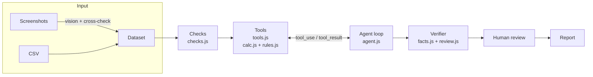

# Design document: Search Report Agent

Status: prototype · Owner: Aaron Chiao · Last updated: October 2026

## 1. Problem

Paid search reports for clients follow a fixed hierarchy (brand → market → keyword category) and are built from a Looker Studio dashboard. The analyst's job each cycle is to explain how each keyword category performed against the previous period and how it moved the market-level results, then recommend actions.

The current AI-assisted process is: screenshot the dashboard, anonymise, paste into a chatbot with a long prompt, check every data point and the logic by hand, then copy usable conclusions into the report. It saves drafting time but has three structural weaknesses:

1. **Arithmetic and reading errors.** Language models predict text; they are unreliable at reading small numbers from images and at calculating shares, CPAs and changes. Errors look plausible.
2. **No questioning of the input.** In one real dataset, four categories added up to the market total this period but covered only ~80% of it in the previous period. A chatbot attributes the market's decline to the four categories, when the decline actually sat in keywords outside them.
3. **Expensive review.** Every number has to be traced back to the dashboard by hand, and the longer the AI's answer, the longer the review.

## 2. Goals and non-goals

Goals
- Produce a four-part analysis (scale and efficiency, category roles, funnel, three recommendations) in the analyst's established structure.
- Every number in the draft is traceable to a calculation; every judgement follows a written rule.
- Review effort moves from checking arithmetic to checking logic and choosing conclusions.
- Nothing reaches a client without human approval.

Non-goals
- Fully automated reporting. The analyst remains accountable for what the client reads.
- Replacing the dashboard. The agent consumes the dashboard's output.
- Year-on-year analysis, new-user metrics (out of scope by decision, see §10).

## 3. Users and workflow

Primary user: a performance marketing analyst preparing a client report. Secondary: account leads reviewing the output.

The agent fits into the existing cycle: dashboard → (screenshots or CSV) → agent → analyst review → report. The analyst keeps the right to approve, edit, remove or reject any part.

## 4. Requirements

| Business need | Technical requirement |
|---|---|
| Numbers in client reports must be right | All maths in deterministic code; the model may only quote numbers returned by tools; a verifier checks every number in the draft |
| Explain how each category moved the market | Contribution shares for volume metrics; rate vs mix decomposition for ratios, which adds up exactly to the market change |
| Category roles that the team agrees with | Roles assigned by written, per-metric rules on change vs previous period; the model must use them verbatim |
| Catch bad input before it becomes a bad conclusion | Reconciliation of categories vs market in both periods; explicit Unallocated scope; "No data" handled as missing |
| Screenshots remain an input option | Vision extraction followed by a code cross-check against the ratios the dashboard displays |
| Client-ready wording | No internal jargon or source IDs in client text; flagged if present |
| Human accountability | Analysis approved as a whole; each recommendation decided separately; export locked until then |

## 5. Architecture

Three layers, each doing only what it is good at:

| Layer | Responsibility | Why |
|---|---|---|
| Code | Read CSV, reconcile, calculate, apply rules, verify | Exact, repeatable, testable |
| Model | Choose what to investigate, explain mechanisms, write client prose | Judgement about emphasis and language |
| Person | Approve, edit, reject, choose conclusions | Accountability and context the model can't see |

### Components

| File | Role |
|---|---|
| `dataset.js` | Data model. Each base metric is `[current, % vs previous period]`; the previous value is rebuilt from the % change. |
| `checks.js` | Reconciliation and scope building (categories + Unallocated). |
| `calc.js` | Contribution and rate/mix decomposition. |
| `rules.js` | Scale-efficiency reading, category roles, funnel reading. All thresholds are constants at the top. |
| `facts.js` | Fact registry (every tool number gets an ID) and the number verifier. |
| `tools.js` | Seven tools exposed to the model. |
| `prompts.js` | Analysis and extraction prompts. |
| `agent.js` | Messages API tool-use loop, capped at 8 rounds. |
| `review.js` | Turns model JSON into a reviewable draft with flags; builds the clean report. |
| `extract.js` | Screenshot reading and cross-check. |

## 6. Agent behaviour scope

The agent may: call any of the seven tools in any order; decide which metrics and categories deserve emphasis; explain mechanisms in plain language; propose three recommendations.

The agent may not: calculate or round numbers; assign or rename category roles; mention source IDs or internal terms in client text; assume context it cannot see (budgets, seasonality, tests in flight).

### Tools

| Tool | Returns |
|---|---|
| `get_overview` | Market totals, ratios and changes; reconciliation result; list of scopes; metrics missing at category level |
| `get_scale_efficiency` | Spend change against Clean QV and eComm clicks; previous, current and incremental CPA; coded reading |
| `get_category_roles` | Roles per category with the numbers behind them and the rules used |
| `get_funnel` | CTR vs QV rate and eComm click rate, market and per scope; coded divergence reading |
| `get_category_contributions(metric)` | Each scope's change and share of the market change |
| `decompose_rate(metric)` | Each scope's rate effect and mix effect on a market ratio |
| `get_category_profile(category)` | All metrics for one category |

Every number in a tool result is returned as `"<value> [F<n>]"`. Tool errors (for example, asking for a metric with no category data) are returned to the model with `is_error`, so it can adjust instead of failing.

## 7. Rules

All judgements are made by code. Thresholds live in `rules.js` and `checks.js`.

**Reconciliation.** Gaps between the sum of categories and the market above 2% are flagged; gaps above 0.5% become an "Unallocated" scope so the market change is always fully explained. In client text this scope is called "keywords outside the reported categories".

**Scale and efficiency** (per downstream metric: Clean QV, eComm clicks). If spend and volume both rose, the cost of each extra unit is compared with the previous average CPA: more than 20% higher is *diminishing returns*, otherwise *efficient scaling*. Other cases: spend up and volume down; efficiency gain; or which fell faster.

**Category roles** (judged on change vs the previous period, per metric):

| Role | Rule |
|---|---|
| Scale anchor (spend) | Largest share of spend this period |
| Efficiency driver (metric) | Largest fall in that metric's CPA, among categories with ≥10% of the metric; none if no CPA fell |
| Cost bottleneck (metric) | Largest CPC rise among categories with ≥10% of the metric whose CPA for that metric also rose; none if none qualifies |

Roles are per metric, so a category can be an efficiency driver for Clean QV and a cost bottleneck for eComm clicks. Because they are longitudinal, a category cannot be both for the same metric.

**Funnel.** CTR and QV rate count as diverging when both move more than 2% in opposite directions.

**Decomposition.** For a ratio R = num/den, each scope's contribution to the market change is split into a rate effect (average weight × change in its own rate) and a mix effect (average rate × change in its weight). The midpoint split makes the effects sum exactly to the market change, so every explanation is checkable.

## 8. Guardrails and failure modes

| Failure mode | Guardrail |
|---|---|
| Screenshot misread | Recompute dashboard ratios from base numbers read; mismatch beyond display precision is flagged per metric |
| Market screenshot taken for a category | Filter reading "Keyword Category" with nothing selected = market; code rejects "Category" as a name |
| Categories don't cover the market | Reconciliation; Unallocated scope; mandatory internal note |
| "No data" treated as zero | Stored as missing; excluded from reconciliation and category analysis; tools refuse category-level questions on it |
| Model invents or recalculates a number | Verifier flags every number not found in the fact registry |
| Model cites a fact that doesn't exist | Flagged |
| Model assigns its own role | Role compared with rule output; flagged and overridden by the rule result in the label |
| Internal jargon or IDs in client text | IDs stripped; jargon flagged |
| Missing categories or recommendation types | Reported as issues |
| Unsupported recommendation | Flagged if it cites no number; each recommendation needs its own approval |
| Agent loops | Hard cap of 8 rounds |
| Output not valid JSON | Tolerant parse, then a clear error |

## 9. Evaluation

Unit tests (`npm test`) cover: reconciliation, Unallocated scope, contributions summing to 100%, rate + mix summing to the market change, role exclusivity, missing-data handling, and the verifier. An agent-loop test uses a fake client to check the tool-use protocol and the flags.

Quality evaluation against real reports (planned): for a set of past periods, compare the agent's draft with the analyst's final report and track (a) share of numbers verified, (b) share of category bullets kept, (c) recommendations approved, (d) review time. The analyst's previous prompt and final reports are the reference.

## 10. Decision log

| Decision | Reason |
|---|---|
| Calculations in code, not the model | Accuracy and traceability |
| Use Clean QV, not Qualified Visits | The dashboard's QV rate and QV CPA are computed on Clean QV (verified from the % changes) |
| Previous period only | Longitudinal comparison against the last period is what the report needs; halves the numbers to read |
| New users excluded | Not used in reporting |
| Roles per metric | A category can be efficient on one metric and under cost pressure on another |
| Roles judged on change, not level | "Getting cheaper" is the insight; "always cheap" is not, and level-based rules produced contradictions |
| Recommendations approved separately | The model can't see budgets, seasonality or tests in flight |
| Ratio cross-check at display precision | The dashboard rounds some ratios to whole numbers |
| Output in four parts | Matches the analyst's established report structure |
| Web page and `src/` kept as two implementations for now | The single-file page is quick to demo inside Claude; the modules are testable and deployable. To be merged so the page loads `src/` |

## 11. Data and privacy

Screenshots and data are sent to the model provider. Use anonymised data for demos and follow company policy for client data. The repository contains only synthetic data. API keys live in `.env`, which is git-ignored.

## 12. Deployment path

The prototype calls the Anthropic Messages API directly. To move to a company platform:

1. Swap the client in `agent.js` and `extract.js` for the approved model endpoint; tools, rules and verifier are model-agnostic.
2. Replace screenshot input with a direct data source (Looker Studio export, BigQuery or Sheets connector), removing the vision step and its error class.
3. Store drafts, decisions and final text to build the evaluation set in §9.
4. Add access control and logging around client data.

## 13. Limitations and next steps

- Screenshot reading depends on image quality; around 2,000 × 500 px per screenshot works well.
- Rules encode one analyst's practice; they should be reviewed with the wider team.
- No memory of previous reports; trends across more than two periods are out of scope.
- The web page and `src/` duplicate the logic; changes must be mirrored until the page loads `src/` directly.
- Next: evaluation set from past reports; data-source connector; reuse the checks, verifier and review layers for the Close Out Report agent.
